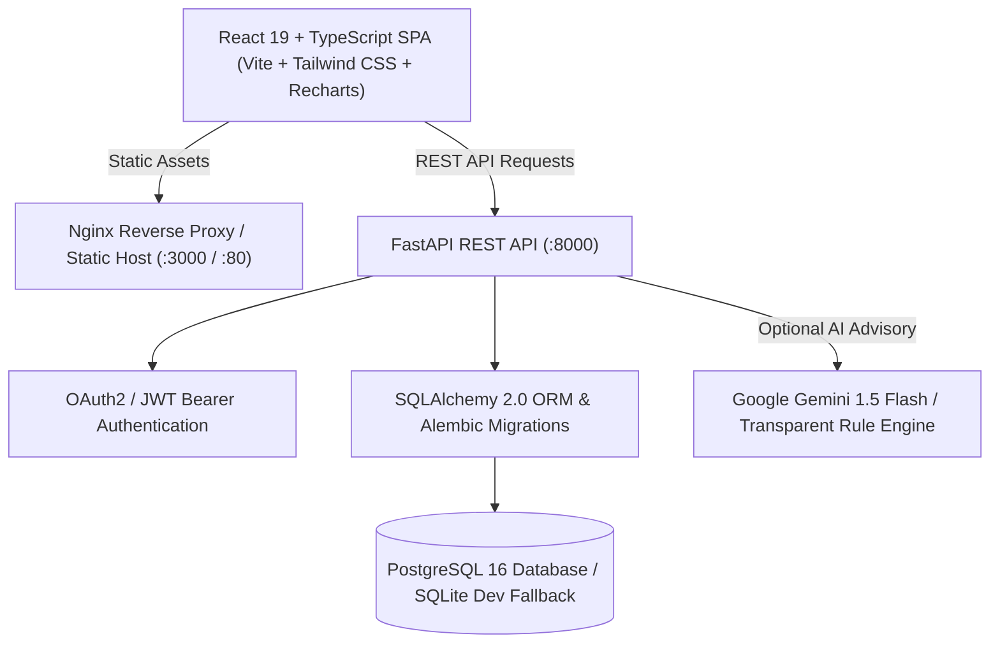

# SpendWise — Smart Personal Expense Tracker & Financial Intelligence

SpendWise is a full-stack, personal finance and smart budgeting web application designed to empower individuals with real-time cash flow monitoring, proactive budget threshold alerts, statistical behavioral trend diagnosis, and optional generative AI financial summaries.

Built using **React + TypeScript + Vite + Tailwind CSS** on the frontend, and **FastAPI + SQLAlchemy + Alembic + PostgreSQL** on the backend.

---

## Architecture Overview

SpendWise is organized as a clean monorepo separating client and server layers with end-to-end data isolation and strict schema validation:



### High-Level Component Layout
```
spendwise/
├── .github/
│   └── workflows/
│       └── ci.yml               # Automated GitHub Actions CI pipeline
├── backend/
│   ├── alembic/                 # Alembic database migration scripts
│   ├── app/
│   │   ├── api/                 # FastAPI API route handlers (auth, txs, budgets, etc.)
│   │   ├── models/              # SQLAlchemy relational data models
│   │   ├── schemas/             # Pydantic v2 data validation schemas
│   │   ├── services/            # Core business logic (analytics, rules, csv, seed)
│   │   ├── config.py            # Pydantic Settings & environment variables
│   │   ├── database.py          # Database engine and session factory
│   │   └── main.py              # Application entrypoint & CORS middleware
│   ├── tests/                   # Pytest test suite (auth, budgets, isolation, etc.)
│   ├── Dockerfile               # Backend Docker container definition
│   ├── pytest.ini              # Pytest configuration
│   └── requirements.txt         # Pinned backend dependencies
├── frontend/
│   ├── src/
│   │   ├── components/          # Reusable UI components & Recharts visualizations
│   │   ├── context/             # AuthContext & ToastContext providers
│   │   ├── pages/               # Routed pages (Dashboard, Ledger, Budgets, Insights, etc.)
│   │   ├── services/            # Axios API client with auth interceptors
│   │   ├── types/               # TypeScript interface definitions
│   │   ├── App.tsx              # Router & Protected Route Guards
│   │   └── main.tsx             # React DOM root entrypoint
│   ├── Dockerfile               # Production multi-stage Docker build with Nginx
│   ├── nginx.conf               # Nginx server configuration with SPA fallback
│   ├── tailwind.config.js       # Tailwind CSS custom financial design tokens
│   ├── vite.config.ts           # Vite bundler & reverse proxy configuration
│   └── package.json             # Pinned frontend dependencies
├── docker-compose.yml           # Multi-container orchestration (DB, API, Frontend)
├── .env.example                 # Environment variable templates
├── .gitignore                   # Version control ignore rules
└── README.md                    # Project documentation
```

---

## Key Features

1. **Secure Authentication & Data Isolation**
   - User registration and login with salted `bcrypt` password hashing.
   - Stateless JWT Bearer token authentication with configurable expiration.
   - Strict multi-tenant row-level user isolation on every query (`WHERE user_id = current_user.id`).
2. **Executive Financial Dashboard**
   - Inflow, outflow, net savings rate, and budget utilization metric cards.
   - Interactive 6-month comparative cash flow grouped bar chart via Recharts.
   - Categorical expense distribution donut chart with interactive custom tooltips.
   - Real-time budget health progress bars and overspending alerts.
3. **Transaction Ledger & Search**
   - Full CRUD: Create, read, edit, search, and delete transactions.
   - Comprehensive filtering by category, transaction type (income vs. expense), date range.
   - Multi-column sorting (date, amount, description) and server-side pagination.
4. **Categories & Tagging**
   - 13 system default categories covering housing, dining, groceries, utilities, and investments.
   - Custom category creation with custom colors and icon tags.
   - Protection preventing unauthorized deletion of system defaults.
5. **Budgets & Overspending Alerts**
   - Monthly category-specific or overall monthly spending limits.
   - Configurable warning thresholds (e.g. 80% or 90%).
   - Automatic visual warning indicators when approaching or exceeding budgets.
6. **Smart Insights & AI Spending Advisory**
   - **Deterministic Statistical Engine**: Month-over-month % delta, weekend vs. weekday spending habits, unusual transaction spike detection, largest single expense analysis, and healthy savings milestone tracking.
   - **Daily Burn Rate**: Computes daily outflow velocity and projects month-end surplus or deficit.
   - **Optional AI Advisory**: Server-side integration with Google Gemini. Seamlessly falls back to transparent deterministic heuristic financial summaries when no API key is provided.
7. **Recurring Transactions & Schedules**
   - Support for daily, weekly, monthly, and yearly recurring schedules.
   - Scheduled due processor that automatically posts due transactions into your ledger.
8. **CSV Import & Export**
   - RFC-4180 standard CSV export with date range and category filtering.
   - CSV file upload with flexible column header normalization.
   - Pre-commit preview with automated duplicate detection (flagging identical date, amount, and description).
9. **Interactive Portfolio Demo Sandbox**
   - One-click **"Seed Demo Data"** action that instantly generates 3 months of realistic salaries, apartment leases, groceries, utilities, and active budgets.
   - Safe **"Reset All Records"** control to return to a clean empty state.

---

## Technology Stack & Versions

| Layer | Technology | Version | Purpose |
| :--- | :--- | :--- | :--- |
| **Frontend Framework** | React + TypeScript | 19.x | Declarative, component-driven UI |
| **Build Tool** | Vite | 8.x | High-speed ESM development and bundling |
| **Styling** | Tailwind CSS | 3.4.x | Utility-first financial design system |
| **Data Visualization** | Recharts | 3.x | SVG charts with responsive animations |
| **Icons** | Lucide React | 1.x | Modern iconography |
| **HTTP Client** | Axios | 1.x | Client requests with auth interceptors |
| **Backend Framework** | FastAPI | 0.151.x | High-performance async Python REST API |
| **ASGI Server** | Uvicorn | 0.54.x | High-throughput web server |
| **Database ORM** | SQLAlchemy | 2.1.x | Type-safe SQL database abstraction |
| **Database Migrations**| Alembic | 1.20.x | Version-controlled schema migrations |
| **Data Validation** | Pydantic v2 | 2.14.x | Schema parsing and request validation |
| **Security** | PyJWT & Bcrypt | 2.15 / 4.1 | JWT authorization & password hashing |
| **Database Engine** | PostgreSQL / SQLite | 16 / 3.x | Persistent relational storage |
| **Containerization** | Docker & Compose | 3.8+ | Multi-service orchestration |
| **Backend Testing** | Pytest & HTTPX | 9.x / 0.28.x| Unit, integration, & isolation testing |
| **Frontend Testing** | Vitest & Testing Lib | 5.x / 16.x | Component testing & DOM assertions |

---

## Local Development Setup

### Prerequisites
- Python 3.10+ (Python 3.11 or 3.13 tested)
- Node.js 18+ (Node.js 20+ recommended)
- Git

### 1. Clone & Configure Environment

```bash
git clone <repository-url>
cd spendwise

# Copy environment variables
cp .env.example .env
```

### 2. Backend Setup

```bash
cd backend

# Create and activate virtual environment
python -m venv venv

# On Windows (PowerShell):
.\venv\Scripts\Activate.ps1
# On Linux/macOS:
source venv/bin/activate

# Install dependencies
pip install -r requirements.txt

# Run database migrations (creates SQLite spendwise.db or PostgreSQL tables)
alembic upgrade head

# Start FastAPI server on port 8000
uvicorn app.main:app --reload --port 8000
```

Backend will be accessible at:
- **API Base:** `http://localhost:8000/api`
- **Interactive Swagger Docs:** `http://localhost:8000/docs`
- **ReDoc Documentation:** `http://localhost:8000/redoc`

### 3. Frontend Setup

In a separate terminal:

```bash
cd frontend

# Install npm dependencies
npm install

# Start Vite dev server (with built-in API proxy to :8000)
npm run dev
```

Frontend will be accessible at: `http://localhost:5173`

---

## Running with Docker Compose

To launch the complete production stack (PostgreSQL database, FastAPI backend, and Nginx-powered React frontend) in isolated containers:

```bash
docker compose up --build
```

Services will start:
- **Frontend Web UI:** `http://localhost:3000`
- **FastAPI Backend:** `http://localhost:8000`
- **Swagger Documentation:** `http://localhost:8000/docs`
- **PostgreSQL Database:** `localhost:5432`

To shut down:
```bash
docker compose down
```

---

## Running Tests

### Backend Test Suite (Pytest)
Runs 22 comprehensive tests verifying authentication, transaction CRUD, budget threshold transitions, custom category protection, CSV validation, scheduled recurrence, and strict multi-tenant data isolation.

```bash
cd backend
.\venv\Scripts\pytest -v
```

### Frontend Test Suite (Vitest)
Runs component tests and visual element assertions in a JSDOM environment:

```bash
cd frontend
npm run test
```

### Production Build Verification
```bash
cd frontend
npm run build
```

---

## API Documentation & Key Endpoints

| Method | Endpoint | Description | Auth Required |
| :--- | :--- | :--- | :--- |
| `POST` | `/api/auth/register` | Register new user account | No |
| `POST` | `/api/auth/login` | Login and obtain JWT access token | No |
| `GET` | `/api/auth/me` | Fetch authenticated user profile | Yes |
| `GET` | `/api/transactions` | List transactions (filter, search, paginate) | Yes |
| `POST` | `/api/transactions` | Record new income or expense transaction | Yes |
| `PUT` | `/api/transactions/{id}` | Update existing transaction | Yes |
| `DELETE`| `/api/transactions/{id}` | Delete transaction | Yes |
| `GET` | `/api/budgets` | Get monthly budgets with live spending status | Yes |
| `POST` | `/api/budgets` | Set or update monthly budget threshold | Yes |
| `GET` | `/api/categories` | List system and custom categories | Yes |
| `POST` | `/api/categories` | Create custom category | Yes |
| `GET` | `/api/recurring` | List recurring schedules | Yes |
| `POST` | `/api/recurring/process-due`| Trigger processing of due recurring rules | Yes |
| `GET` | `/api/analytics/dashboard` | Dashboard metrics, cash flow, category breakdown | Yes |
| `GET` | `/api/analytics/insights` | Rule-based statistical insights + AI summary | Yes |
| `GET` | `/api/csv/export` | Download transactions in CSV format | Yes |
| `POST` | `/api/csv/preview` | Upload and preview CSV with duplicate detection | Yes |
| `POST` | `/api/csv/import` | Batch import validated CSV records | Yes |
| `POST` | `/api/seed/demo-data` | Seed 3-months of realistic demo data | Yes |
| `DELETE`| `/api/seed/reset-data` | Wipe account data back to empty state | Yes |

---

## Security & Data Integrity Highlights

- **Per-User Isolation**: Every database query explicitly filters by the current user's authenticated ID. Direct object reference attempts by User B to access User A's records return HTTP 404.
- **Salted Password Hashing**: Passwords are never stored in plain text; hashed using industry-standard bcrypt.
- **Stateless Bearer Tokens**: JSON Web Tokens (PyJWT) with signed expiration and signature validation.
- **Input Sanitization**: Pydantic v2 schemas rigorously validate and normalize dates, amounts, email addresses, and character limits before hitting the database.
- **Safe Fallback AI**: When `GEMINI_API_KEY` is not provided, SpendWise automatically falls back to deterministic mathematical rules with zero external network dependencies.

---

## Screenshots Guidance

When capturing screenshots for a portfolio or demonstration, use the **"Seed Demo Data"** button to populate rich visual history:
1. **Executive Dashboard**: Highlight the Cash Flow grouped bar chart, category donut breakdown, and overspending warning cards.
2. **Transaction Ledger**: Display search in action with category badges, recurring icons, and pagination controls.
3. **Smart Insights & AI Advisory**: Capture the Burn Rate forecast, projected surplus/deficit card, and AI Executive Summary.
4. **CSV Import Preview**: Showcase the duplicate detection preview highlighting valid rows vs flagged duplicates.

---

## Future Roadmap

- [ ] Multi-currency real-time conversion rates (ECB API integration).
- [ ] Receipt OCR scanning with automatic amount and merchant extraction.
- [ ] Split transactions (dividing one transaction across multiple categories).
- [ ] Webhook triggers for automated mobile push notifications when budget exceeds 90%.
- [ ] Two-Factor Authentication (TOTP via Google Authenticator).
